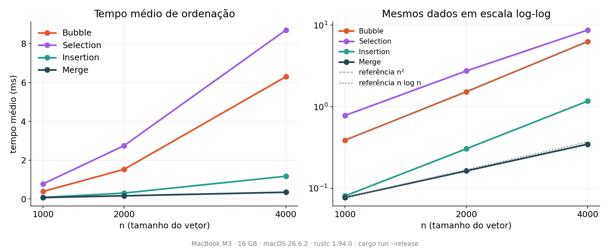
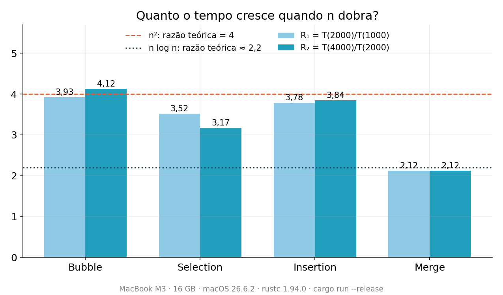
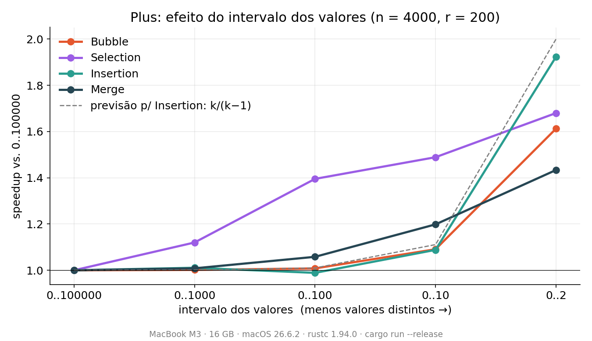

# Comparação Experimental de Algoritmos de Ordenação

**Complexidade Algorítmica — Trabalho 1**

Universidade do Distrito Federal (UnDF) · Ciência da Computação · Prof. Dr. Jayme Milanezi Junior · Outubro de 2026

**Grupo:** Emanuel Ribeiro, Arthur Mendes e Adler

**Linguagem:** Rust · **Ambiente:** MacBook M3, 16 GB de RAM, macOS 26.6.2, rustc 1.94.0 (Homebrew), compilado com `cargo run --release`

---

## 1. Objetivo

Comparar, por meio de experimentos, o tempo de execução de quatro algoritmos de ordenação — **Bubble Sort**, **Selection Sort**, **Insertion Sort** e **Merge Sort** — e relacionar os resultados com suas ordens assintóticas: `Θ(n²)` para os três primeiros e `Θ(n log n)` para o Merge Sort (escolhido entre Merge e Heap).

Além do pedido no enunciado, fizemos um **plus**: medir como o tempo muda quando os valores do vetor vêm de um intervalo menor (mais elementos repetidos).

## 2. Metodologia

| Bateria | Tamanho `n` | Realizações `r` |
|:---:|:---:|:---:|
| 1 | 1000 | 10.000 |
| 2 | 2000 | 2.500 |
| 3 | 4000 | 625 |

Em cada realização:

1. Gera-se **um** vetor aleatório com `n` inteiros em `0..100000`.
2. Cada algoritmo recebe uma **cópia idêntica** desse vetor, então os quatro ordenam exatamente os mesmos dados.
3. Mede-se **somente** a ordenação (`Instant::now()` antes e `elapsed()` depois). A geração do vetor e a cópia ficam fora do tempo.
4. Ao final, calcula-se a **média** dos `r` tempos de cada algoritmo.

Dois cuidados extras: os vetores usam uma **seed fixa (42)**, para que qualquer pessoa gere os mesmos dados, e o programa confere, fora do cronômetro, que a saída de cada algoritmo está realmente ordenada. Antes da primeira medição há também um **aquecimento descartado** (200 realizações com `n = 2000`), que não aparece em nenhuma tabela.

## 3. Resultados

Tempo médio de ordenação por algoritmo:

| Algoritmo | n = 1000 | n = 2000 | n = 4000 |
|---|---:|---:|---:|
| **Bubble Sort** | 389,0 µs | 1,527 ms | 6,298 ms |
| **Selection Sort** | 780,9 µs | 2,746 ms | 8,703 ms |
| **Insertion Sort** | 80,7 µs | 305,3 µs | 1,173 ms |
| **Merge Sort** | **77,3 µs** | **163,8 µs** | **347,8 µs** |



*Figura 1 — À esquerda, os algoritmos quadráticos se afastam rapidamente do Merge Sort. À direita (escala log-log), uma função `n^k` vira uma reta de inclinação `k`: Bubble acompanha a referência `n²` e o Merge acompanha `n log n`.*

**Quantas vezes o Merge Sort é mais rápido:**

| n | vs. Bubble | vs. Selection | vs. Insertion |
|:---:|:---:|:---:|:---:|
| 1000 | 5,0× | 10,1× | 1,04× |
| 2000 | 9,3× | 16,8× | 1,9× |
| 4000 | **18,1×** | **25,0×** | **3,4×** |

A vantagem do Merge Sort **cresce com `n`**, como esperado para `Θ(n log n)` contra `Θ(n²)`.

## 4. Relação com a complexidade assintótica

Ao dobrar `n`, um algoritmo `Θ(n²)` deve levar cerca de **4×** mais tempo, e um `Θ(n log n)` cerca de **2,2×**. Calculamos `R₁ = T(2000)/T(1000)` e `R₂ = T(4000)/T(2000)`:

| Algoritmo | R₁ | R₂ | Esperado |
|---|:---:|:---:|:---:|
| Bubble Sort | 3,93 | 4,12 | 4 |
| Selection Sort | 3,52 | 3,17 | 4 |
| Insertion Sort | 3,78 | 3,84 | 4 |
| **Merge Sort** | **2,12** | **2,12** | ≈ 2,2 |



*Figura 2 — Os algoritmos quadráticos ficam perto de 4 (o Selection ficou abaixo, ver seção 6). O Merge Sort fica em ≈ 2,1.*

Outra forma de ver: dividir o tempo pela função de crescimento esperada deve dar algo aproximadamente constante (a "constante oculta" da notação `Θ`).

| Algoritmo | Medida | n = 1000 | n = 2000 | n = 4000 |
|---|---|:---:|:---:|:---:|
| Bubble | T / n² (ns) | 0,389 | 0,382 | 0,394 |
| Insertion | T / n² (ns) | 0,081 | 0,076 | 0,073 |
| Merge | T / (n·log₂n) (ns) | 7,75 | 7,47 | 7,27 |

> **O que o `Θ` diz e o que não diz.** Ele descreve a *forma do crescimento*, não o tempo absoluto. Um exemplo está nos nossos dados: em `n = 1000`, o Insertion Sort (`Θ(n²)`) praticamente empata com o Merge Sort (`Θ(n log n)`), 80,7 µs contra 77,3 µs. Isso não contradiz a teoria: as constantes ocultas diferem, e a vantagem assintótica só aparece quando `n` cresce. Em `n = 4000` o Merge já é 3,4× mais rápido.

## 5. Plus: influência do intervalo dos valores

**Pergunta:** o tempo depende do *intervalo* dos valores sorteados? Fixamos `n = 4000` e `r = 200` e sorteamos valores em `0..N`, com `N` cada vez menor. Quanto menor o `N`, mais valores repetidos. Entre parênteses está o **speedup** em relação a `0..100000` (`tempo base / tempo`, maior = mais rápido).

| Intervalo | Bubble | Selection | Insertion | Merge |
|---|---:|---:|---:|---:|
| `0..100000` (base) | 6,292 ms | 8,805 ms | 1,183 ms | 347,9 µs |
| `0..1000` | 6,282 ms (1,00×) | 7,861 ms (1,12×) | 1,170 ms (1,01×) | 345,0 µs (1,01×) |
| `0..100` | 6,240 ms (1,01×) | 6,311 ms (1,40×) | 1,196 ms (0,99×) | 328,7 µs (1,06×) |
| `0..10` | 5,767 ms (1,09×) | 5,914 ms (1,49×) | 1,087 ms (1,09×) | 290,3 µs (1,20×) |
| `0..2` | 3,902 ms (1,61×) | 5,241 ms (1,68×) | 615,1 µs (**1,92×**) | 242,7 µs (1,43×) |



*Figura 3 — Todos os algoritmos ficam mais rápidos com mais repetidos, mas de formas diferentes. A linha tracejada é a previsão teórica para o Insertion Sort.*

**Insertion Sort (explicação com previsão numérica).** O trabalho do Insertion é proporcional ao número de *inversões* (pares fora de ordem), porque cada troca desfaz uma. Como a comparação é estrita (`>`), elementos iguais não são trocados. Com `k` valores possíveis, a chance de um par estar invertido é `(1 − 1/k)/2`, então o speedup esperado é aproximadamente `k/(k−1)`:

| Intervalo | k | Previsto | Observado |
|---|:---:|:---:|:---:|
| `0..1000` | 1000 | 1,001× | 1,01× |
| `0..100` | 100 | 1,010× | 0,99× |
| `0..10` | 10 | 1,111× | 1,09× |
| `0..2` | 2 | **2,000×** | **1,92×** |

A previsão acerta o comportamento: quase nenhum efeito para intervalos grandes e um salto quando restam poucos valores distintos.

**Os demais.** No **Bubble**, o número de trocas também é igual ao de inversões, e a parada antecipada passa a ajudar quando há poucos valores. No **Selection**, o número de comparações é sempre `n(n−1)/2`, então o ganho de até 1,68× não vem de "menos comparações", e sim de cada passo ficar mais barato. No **Merge**, o ganho de até 1,43× é moderado. Para os três, nossa **hipótese** é que o desvio condicional fica mais previsível com muitos valores repetidos. Não medimos isso diretamente (seria preciso um profiler).

**Conclusão do plus:** a distribuição dos dados muda o tempo por **fatores constantes** (no máximo ≈ 1,9×), mas não muda a ordem de crescimento, e continua muito menor que a diferença de 18× a 25× entre o Merge e os quadráticos.

## 6. Discussão e conclusões

**O que os resultados confirmam.**

- Os algoritmos `Θ(n²)` multiplicaram o tempo por ≈ 4 ao dobrar `n` (Bubble 3,93 e 4,12; Insertion 3,78 e 3,84), enquanto o Merge Sort multiplicou por ≈ 2,1, bem perto do teórico (≈ 2,2).
- A distância entre as famílias **cresce com `n`**: Merge contra Bubble foi de 5,0× para 9,3× e depois 18,1×.

**Por que o Insertion foi o melhor dos quadráticos?** Em entradas aleatórias o Insertion faz cerca de `n²/4` comparações e trocas, enquanto o Bubble e o Selection fazem cerca de `n²/2` comparações. Além disso, o laço interno do Insertion provavelmente é mais previsível para o processador (hipótese, não medida). Na prática, a constante do Insertion foi ≈ 5× menor que a do Bubble (0,08 ns contra 0,39 ns por `n²`).

**Comportamento inesperado: o Selection Sort.** Em teoria o Selection faz só `O(n)` trocas contra `O(n²)` do Bubble, então esperaríamos que ele fosse mais rápido. Foi o contrário (8,7 ms contra 6,3 ms em `n = 4000`), e sua razão de crescimento ficou abaixo de 4 (3,52 e 3,17): o custo por `n²` caiu de 0,78 ns para 0,54 ns. Testamos a explicação mais simples, "a CPU ainda estava esquentando na primeira bateria": adicionamos um aquecimento descartado e repetimos o experimento, e **o comportamento se manteve** igual ao da rodada sem aquecimento; logo, não parece ser efeito de CPU fria. Nossa **hipótese** é que o laço do Selection, que compara sempre com `arr[min_index]`, cria uma dependência de dados entre iterações que limita o paralelismo de instruções, mas confirmar isso exigiria inspecionar o assembly ou usar contadores de hardware. Deixamos como ponto em aberto.

**Conclusão.** O experimento permite distinguir claramente as duas famílias: `Θ(n²)` multiplica o tempo por ≈ 4 quando a entrada dobra, e `Θ(n log n)` por ≈ 2,1. A notação assintótica diz **como** o custo cresce; as constantes (implementação, cache, previsão de desvios) dizem **onde** as curvas se cruzam. É por isso que, em `n` pequeno, um quadrático bem comportado como o Insertion pode empatar com um `n log n`. O plus reforça essa leitura: mudar a distribuição dos dados altera o tempo por fatores constantes, mas não a ordem de crescimento.

## 7. Reprodutibilidade e limitações

```bash
# requer Rust com edição 2024 (rustc >= 1.85) — https://rustup.rs
cargo run --release
```

- **Sempre use `--release`.** Em modo debug os tempos são muito maiores e não representativos.
- **Mesmos dados em qualquer máquina:** seed fixa (42) e `Cargo.lock` versionado. Os **tempos absolutos** dependem do computador, mas as conclusões sobre crescimento e ordem relativa não.
- **Estabilidade:** rodamos o programa **duas vezes** no mesmo computador e as médias da Parte 1 diferiram em no máximo **2%** (a saída completa da segunda execução está no Apêndice F), com os mesmos speedups no plus.
- **Limitações:** um único computador; o plus usa `r = 200` (menos que as 625 realizações da bateria principal para `n = 4000`); as explicações sobre previsão de desvios e dependência de dados são hipóteses que não medimos com um profiler.

---

# Apêndices

Estrutura do projeto:

```text
trabalho_1/
├── Cargo.toml
├── Cargo.lock
└── src/
    ├── main.rs                    # Apêndice B — experimento (Parte 1 e plus)
    ├── utils.rs                   # Apêndice C — geração dos vetores e medição
    └── metodos_de_ordenacao.rs    # Apêndice D — os quatro algoritmos
```

## Apêndice A — `Cargo.toml`

```toml
[package]
name = "trabalho_1"
version = "0.1.0"
edition = "2024"

[dependencies]
rand = "0.10.3"
```

## Apêndice B — `src/main.rs`

```rust
mod metodos_de_ordenacao;
mod utils;

use crate::metodos_de_ordenacao::{bubble, insertion, merge, selection};
use crate::utils::{gerar_vetor, medir, novo_rng};
use rand::rngs::StdRng;
use std::time::Duration;

/// Roda uma bateria: r vetores aleatórios de tamanho n, com valores em 0..max.
/// Cada vetor é ordenado pelos 4 algoritmos. Retorna a média de cada um,
/// na ordem [Selection, Insertion, Bubble, Merge].
fn bateria(rng: &mut StdRng, n: usize, r: u32, max: i32) -> [Duration; 4] {
    let mut totais = [Duration::ZERO; 4];

    for _ in 0..r {
        let original = gerar_vetor(rng, n, max);

        totais[0] += medir(&original, selection);
        totais[1] += medir(&original, insertion);
        totais[2] += medir(&original, bubble);
        totais[3] += medir(&original, merge);
    }

    totais.map(|t| t / r)
}

fn main() {
    let mut rng = novo_rng();

    // Aquecimento (resultado descartado): deixa CPU e caches em regime
    // antes da primeira medição. Não aparece em nenhuma tabela.
    bateria(&mut rng, 2_000, 200, 100_000);

    // ---------- PARTE 1: bateria obrigatória (n, r) ----------
    let cenarios: [(usize, u32); 3] = [(1_000, 10_000), (2_000, 2_500), (4_000, 625)];

    println!("=== PARTE 1: Tempo médio por algoritmo (valores em 0..100000) ===");
    println!(
        "{:>6} {:>8} | {:>12} {:>12} {:>12} {:>12}",
        "n", "r", "Selection", "Insertion", "Bubble", "Merge"
    );
    println!("{}", "-".repeat(72));

    for (n, r) in cenarios {
        let m = bateria(&mut rng, n, r, 100_000);
        println!(
            "{:>6} {:>8} | {:>12} {:>12} {:>12} {:>12}",
            n,
            r,
            format!("{:?}", m[0]),
            format!("{:?}", m[1]),
            format!("{:?}", m[2]),
            format!("{:?}", m[3])
        );
    }

    // ---------- PARTE 2 (PLUS): reduzindo o intervalo dos valores ----------
    let n = 4_000;
    let r = 200; // menos realizações para o plus não demorar demais
    let intervalos: [i32; 5] = [100_000, 1_000, 100, 10, 2]; // o primeiro é a referência

    println!();
    println!("=== PARTE 2 (PLUS): n = {}, r = {} ===", n, r);
    println!(
        "{:>9} | {:>12} {:>12} {:>12} {:>12}",
        "valores", "Selection", "Insertion", "Bubble", "Merge"
    );
    println!("{}", "-".repeat(67));

    let mut referencia: Option<[Duration; 4]> = None;

    for max in intervalos {
        let m = bateria(&mut rng, n, r, max);
        let base = *referencia.get_or_insert(m);

        println!(
            "{:>9} | {:>12} {:>12} {:>12} {:>12}",
            format!("0..{}", max),
            format!("{:?}", m[0]),
            format!("{:?}", m[1]),
            format!("{:?}", m[2]),
            format!("{:?}", m[3])
        );

        // Speedup = tempo da referência / tempo atual
        let s = |i: usize| format!("{:.2}x", base[i].as_secs_f64() / m[i].as_secs_f64());
        println!(
            "{:>9} | {:>12} {:>12} {:>12} {:>12}",
            "speedup",
            s(0),
            s(1),
            s(2),
            s(3)
        );
    }
}
```

## Apêndice C — `src/utils.rs`

```rust
use rand::rngs::StdRng;
use rand::{RngExt, SeedableRng};
use std::time::{Duration, Instant};

/// Semente fixa: qualquer pessoa que rode o código gera exatamente os mesmos vetores.
/// (Os tempos variam de máquina para máquina, mas as entradas são sempre as mesmas.)
const SEMENTE: u64 = 42;

pub fn novo_rng() -> StdRng {
    StdRng::seed_from_u64(SEMENTE)
}

pub fn gerar_vetor(rng: &mut StdRng, tamanho: usize, max: i32) -> Vec<i32> {
    (0..tamanho).map(|_| rng.random_range(0..max)).collect()
}

pub fn medir(original: &[i32], algoritmo: fn(&mut [i32]) -> &mut [i32]) -> Duration {
    let mut copia = original.to_vec(); // a cópia não entra no tempo

    let inicio = Instant::now();
    algoritmo(&mut copia);
    let tempo = inicio.elapsed();

    // Fora do cronômetro: garante que o algoritmo realmente ordenou o vetor.
    assert!(copia.is_sorted(), "o algoritmo não ordenou o vetor");
    tempo
}
```

## Apêndice D — `src/metodos_de_ordenacao.rs`

```rust
pub fn selection<T: PartialOrd>(arr: &mut [T]) -> &mut [T] {
   let n = arr.len();

    for i in 0..n {

        let mut min_index = i;

        for j in (i + 1)..n {
            if arr[j] < arr[min_index] {
                min_index = j;
            }
        }

        if min_index != i {
            arr.swap(i, min_index);
        }
    }
    arr
}

pub fn insertion<T: PartialOrd>(arr: &mut [T]) -> &mut [T] {

    let n = arr.len();

    for i in 1..n {
        let mut j = i;

        while j > 0 && arr[j - 1] > arr[j] {
            arr.swap(j - 1, j);
            j -= 1;
        }
    }

    arr
}

pub fn bubble<T: PartialOrd>(arr: &mut [T]) -> &mut [T] {
    let n = arr.len();

    for i in 0..n {
        let mut trocou = false;

        for j in 0..(n - 1 - i) {
            if arr[j] > arr[j + 1] {
                arr.swap(j, j + 1);
                trocou = true;
            }
        }

        if !trocou {
            break;
        }
    }

    arr
}

pub fn merge<T: PartialOrd + Clone>(arr: &mut [T]) -> &mut [T] {
    let n = arr.len();

    if n <= 1 {
        return arr;
    }

    let meio = n / 2;

    // Ordena cada metade recursivamente
    {
        let (esq, dir) = arr.split_at_mut(meio);
        merge(esq);
        merge(dir);
    }

    // Copia as metades já ordenadas para vetores auxiliares
    let esq = arr[..meio].to_vec();
    let dir = arr[meio..].to_vec();

    let (mut i, mut j, mut k) = (0, 0, 0);

    // Intercala as duas metades de volta em arr
    while i < esq.len() && j < dir.len() {
        if esq[i] <= dir[j] {
            arr[k] = esq[i].clone();
            i += 1;
        } else {
            arr[k] = dir[j].clone();
            j += 1;
        }
        k += 1;
    }

    // Sobras de alguma das metades
    while i < esq.len() {
        arr[k] = esq[i].clone();
        i += 1;
        k += 1;
    }

    while j < dir.len() {
        arr[k] = dir[j].clone();
        j += 1;
        k += 1;
    }

    arr
}
```

## Apêndice E — Saída do programa (execução 1, usada nas tabelas)

```text
=== PARTE 1: Tempo médio por algoritmo (valores em 0..100000) ===
     n        r |    Selection    Insertion       Bubble        Merge
------------------------------------------------------------------------
  1000    10000 |    780.919µs     80.701µs    388.975µs      77.26µs
  2000     2500 |   2.746093ms    305.285µs   1.527039ms     163.83µs
  4000      625 |   8.702528ms   1.172746ms   6.298327ms    347.829µs

=== PARTE 2 (PLUS): n = 4000, r = 200 ===
  valores |    Selection    Insertion       Bubble        Merge
-------------------------------------------------------------------
0..100000 |   8.804987ms   1.183086ms    6.29153ms    347.875µs
  speedup |        1.00x        1.00x        1.00x        1.00x
  0..1000 |    7.86057ms   1.170361ms   6.281813ms    344.972µs
  speedup |        1.12x        1.01x        1.00x        1.01x
   0..100 |   6.310745ms   1.196432ms   6.240488ms    328.736µs
  speedup |        1.40x        0.99x        1.01x        1.06x
    0..10 |   5.913545ms   1.087167ms   5.767242ms    290.256µs
  speedup |        1.49x        1.09x        1.09x        1.20x
    0..2 |   5.241383ms    615.127µs   3.901733ms    242.655µs
  speedup |        1.68x        1.92x        1.61x        1.43x
```

## Apêndice F — Saída do programa (execução 2, conferência)

```text
=== PARTE 1: Tempo médio por algoritmo (valores em 0..100000) ===
     n        r |    Selection    Insertion       Bubble        Merge
------------------------------------------------------------------------
  1000    10000 |    796.621µs      82.31µs    396.781µs     78.084µs
  2000     2500 |   2.756964ms    309.554µs   1.539476ms    163.571µs
  4000      625 |    8.82557ms   1.184085ms   6.301523ms    342.261µs

=== PARTE 2 (PLUS): n = 4000, r = 200 ===
  valores |    Selection    Insertion       Bubble        Merge
-------------------------------------------------------------------
0..100000 |   8.834035ms   1.192132ms   6.300449ms    342.337µs
  speedup |        1.00x        1.00x        1.00x        1.00x
  0..1000 |   7.912734ms   1.207459ms   6.281578ms    341.805µs
  speedup |        1.12x        0.99x        1.00x        1.00x
   0..100 |   6.299261ms   1.186514ms   6.221815ms    321.386µs
  speedup |        1.40x        1.00x        1.01x        1.07x
    0..10 |    5.91866ms   1.085511ms   5.762339ms    290.786µs
  speedup |        1.49x        1.10x        1.09x        1.18x
    0..2 |   5.260532ms    614.669µs   3.885564ms    243.867µs
  speedup |        1.68x        1.94x        1.62x        1.40x
```
# ordenacao-benchmark-rust
